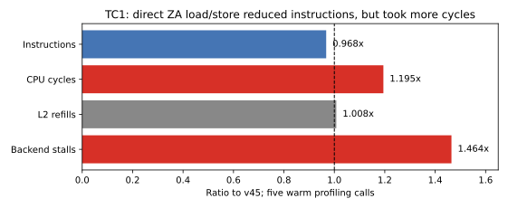

## 2026-09-12 02:18 续轮：TC1 与通用 INT8/RNS 原型

本轮实验基线为 v44 / 519b2f4，实验本身未修改生产 trsm.c；没有新的完整 TRSM 提速。归档时远端已新增队友的 v45 / 28354b1，大页改动需保留，本文性能不代表对 v45 的复验。用户休息期间要求不再弹出审批，本轮只沿用已批准的 SSH/SCP 等命令，不发起新增权限审批。专用作业 1574785 / cn20486 仍在运行，00:46:21 开始、限时 7200 秒，截止约 02:46:21；所有请求到 356 已完成，下个编号 357。不得因为观测超时重启该作业或提交重叠作业。

### TC1

343 的代码生成宏匹配错误导致编译失败；修正为只解析宏续行后 344 完成验证。NC104 分块配套 8 列尾内核，正式 bench 三轮全部 PASS、误差 3.33e-16，但中位 2643.2338 vs 同组 v44 2760.5885（-4.25%）。负结论不是指 NC104 必然无效，而是这一实现未赢；profile 主循环约 1.04 vs 1.01 ms，尾部最大跨度虽减小，平均空闲并未降低。代码在 make-owner104.py / trsm-owner104.c。

346 的输入 B 读入改用 ldnt1d，四轮中位 2737.7180 vs 2777.5727（-1.44%），全部 PASS，不合入。候选 trsm-owner-loadnt44.c。生产数据独立于 profile 版本；相位和 GFLOPS 不混用。

### 340–342：精度能力与 CRT 重构

纯寄存器 38 核峰值重新测得 F64≈7.54 TFLOPS、F32≈15.06、F16/BF16≈30.12、I8≈120.36 TOPS。与历史 235 的结果一致，不是首次发现；它们不是等精度求解器分数。

原型使用 13 个素数 [251,241,239,233,229,227,223,211,199,197,193,191,181]，乘积 M=2155171312918486894641801011047（约 100.766 位）。q=round(x·2^45)，取中心余数后在 INT8 做模点积；|x|≤0.5、K≤2048 的最坏整数点积不会绕过 M/2。固定量化用于任意独立 53 位输入，不使用官方生成器格点、随机状态或输出缓存。

固定小数 CRT：w_p=round(2^64·inv(M/p mod p)/p)，F=Σ remainder_p·w_p mod 2^64，输出 signed(F)·M/2^90/2^64。模 2^64 无符号环绕是有意的。13 模数和中心余数给出约 8e-14 的 CRT 系数舍入绝对界（微基准输入契约下），还必须另计输入量化、最终 FP64 转换和三角求解的误差传播。

341 双双精度重构、342 固定小数重构在 K128..2048 的独立 53 位随机、全正 0.5、正负交替模式，逐个检查全部 1024 输出，相对 __int128 量化点积参考最大误差 ≤5.68e-14；相对原浮点长双精度点积误差约 4.7e-13。这里只验证点积，不能代替三角求解的精度保护。K512 完整微内核从约 44 GFLOPS/core 改到约 59，但不同二进制的 raw 吞吐也有差异，不能将全部变化归因于重构方法。

### 345、347：编码成本

实现了 SVE 浮点余数编码，以及六个平衡基 256 数位通过两条 SMOPA 批量生成 13 模数的编码。所有输出均与独立标量模参考逐字节一致，包括 1024×1024 数据。SME 编码并未优于 SVE：小块约 5.77 vs 4.18 ns/输入系数。反汇编显示当前两个编码函数已展开素数循环，循环体没有 FDIV；不能继续把标量除法视为它们的已确认热点。

改成 16 行块后，1024×1024 的 SVE 编码约 9.58→8.19 ns/输入（该组件改善约 15%）；小尺寸由 4.18 变成 7.61，说明存在布局与寄存器/临时数据开销权衡。编码不是免费成本，尚未加入完整求解器。

### 348–356：完整分块矩阵更新、线程与 PMU

M=N=512、K=2048 的分块原型含 13 模数矩阵乘和 CRT；不含输入编码、TRSM 对角解或误差回退。每组选择 32 个输出与 __int128 参考对照，不是全矩阵验证。348 在首次数值检查后出现 SIGILL；把 SME 状态切换移到 OpenMP 运行时调用之外后，349 及后续正常完成，根因未取得 core 指令证据，不能断言已定位具体非法指令。

测试了整行跨步输入、连续 16×64 微面板、完整 K 保留 ZA、32×32 方形微内核、双组寄存器流水、A 非临时读取、K 分裂和行块。352 另测 K8192 / Q43（重新调整 CRT 尺度，最坏整数点积范围可容纳），抽查误差 2.274e-13；仍不是端到端求解验证。

353 的 1/8/38 线程原始矩阵更新约 45.8 / 300 / 1100–1400 等效 GFLOPS，CPU38–75 分别被使用，任务耗时显示单核路径已经慢，并非所有线程挤在同一个核。355 的六事件组 running=enabled；warm 测量约 38.7–40.2M cycles，后端停顿 26.6–27.0M，L2 refill≈2.94M cache lines（约 188 MB 重填量）。流水和 A-NT 基本未改变重填数。重填量不是直接测得的 HBM 总线流量。PMU ioctl/屏障显著增加总墙钟，不用该墙钟给原型排名。

356 改为 MB64/128/256 行块、NC128/256/512、完成整数 tile 后直接非临时写结果。当前筛选中最好完整阶段 MB256 NC256、K 分裂 2：0.68257 / 0.68374 ms，即 1573.084 / 1570.386 等效 GFLOPS。它只是研究微基准，不能与正式 TRSM GFLOPS 当作同一测试进行胜负比较；目前没有足够证据支持接入生产或宣称 30%–70% 端到端增益。

### 后续方向

- 已排除这一批参数与实现，避免无理由重跑。RNS 后续必须先有明显降低字节数或重构/编码成本的新依据；不因 120 TOPS 峰值就继续堆变体。
- 回到纯 FP64 的主循环访存和 TC1 对角/读入成本；大幅增益仍需算法或数据复用层面的变化。此前所有历史负结果仍有效，详见原报告。
- 若继续量化研究，必须给实际输入范围、量化/重构误差传播、原始 B 保存及 FP64 回退；不依赖 bench 的 X 幅度随 m 衰减（它不衰减）。
- 当前没有新生产候选可推送；实验源和所有日志保留在本目录。v44 已推送，远端随后包含队友的 v45；本研究未改变内核算术。

### 合并队友 v45 后的独立同机复验

357 在 cn20486、38 线程、原始 bench 上交错各三轮，每轮计时 7 次。v44/v45 的 GFLOPS 中位数分别为 TC1 2729.4661/2754.4228，TC2 4163.2247/4167.9949，TC3 4139.1955/4139.5742；整体持平，TC1 样本有波动，不将这组三轮的中位数偏移单独宣称为稳定提速。12 次正式尺寸换输入检查全部通过，最大误差 3.33e-16 / 7.77e-16 / 1.50e-15；无 SME 编译通过。[逐轮数据](../logs/v45_same_node.csv)。

已保留队友 28354b1 及前置 v45 提交，并以牛嘉胤 / njy24 身份推送研究记录。生产 trsm.c 与队友版本逐字节一致，SHA256 为 3f4583abb9668230fdeec71a8f4cbfd669d013365ceec08e2eac3ff4e2d6df88。下一轮基线改为 v45；这次研究本身没有新的端到端性能优化。

## v45 后续：面板交错、6 字节存储与 ZA 直接累加（358–365）

本轮继续基于 v45，生产 trsm.c 未修改。所有数据来自同一专用 cn20486 作业；每条候选均先看实际正确性输出，不仅看进程退出码。没有新增端到端提速，未合入这些候选。

358：同线程交错相邻面板的前缀行块，两个驻留缓冲各自保存 X。正式用例均 PASS；128/256/384 行交错前缀的三轮中位数约 2463 / 2357 / 2017 GFLOPS，对照 v45 约 2771。缓存工作集增加抵消了 L 的共享，384 行的 profile 主循环约 1.65 ms，明显高于基线约 1.01 ms。

359/360：6 字节有符号整数存储 q=round(A·2^47)，读取时用 TBL 展开并恢复 FP64，B 和所有乘加仍为 FP64。原型输入为独立 53 位随机值，|A|≤0.5；没有生成器格点依赖。359 将 ptrue p0.d 误用于逐字节读取导致检查失败，改成 ptrue p0.b 后通过。双流微基准每 K 步约 20.16 周期 vs FP64 10.69，解码成本超过省下的流量；输入编码成本尚未计入。

361/363：将 q+2^47 存为 48 位无符号整数，TBL 展开后置入 FP64 的尾数，再减去 33.0，即可精确还原量化值，省去 SCVTF 和缩放乘法。361 的常量装载不能编码为单条 MOV，改为 MOV+ORR 后 363 通过。全部 512 个微块输出相对原浮点 long double 点积误差 1.643e-14，相对量化点积参考误差 8.882e-16。直接解码约 15.65 周期/K；每条 A 只解码一次再复用降至约 12.55，但对照约 10.66，仍慢约 18%。这些是局部微基准，不是带范围检查、误差传播和回退的完整 TRSM。

362：对角阶段使用 ST1D ZA 直接存储，替代 MOVA+ST1D Z。正式四轮 PASS，候选中位 2770.66 vs 2764.81 GFLOPS，逐轮正负交替，不能据此宣称稳定收益。对角转存相位略降，整体没有足够可复验增益。

364：用 LD1D ZA 预装 C、FMOPS 原位累加、ST1D ZA 写回，并在另一组 bank 计算时交错读写。正式三轮 PASS，最大误差 2.33e-15，但中位 2359.05 vs v45 2756.70 GFLOPS，主循环约 1.34 vs 1.01 ms。

365 的六事件 PMU（排除首调用，五次 warm、running=enabled）解释了该负结果：指令数 170.68M→165.16M（-3.23%），周期 101.42M→121.14M（+19.45%），L2 refill 6.834M→6.887M（+0.78%），后端停顿 43.71M→64.01M（+46.45%）。因此，更少的搬运指令并未加快执行；计数更支持 ZA 读写/执行调度开销增加，而非缓存重填量明显增多。这里不能仅凭总计数确定是哪一个内部流水端口。

[正式逐轮对照](../logs/v45_tc1_followup.csv)、[完整 warm PMU 计数](../logs/v45_directza_pmu.csv)。研究源、生成脚本、包括失败在内的原始日志均归档到工作区旁 trsm-profile-20260912/probes。

后续若继续紧凑存储，需尝试把一次解码与上一条带的计算重叠，并把编码、范围/误差保护及首条启动成本全部计入；不应重复在每次 FMOPA 读取时解码。该设想尚未实现或证明有收益。TC1 和其他纯 FP64 路线仍需继续。
