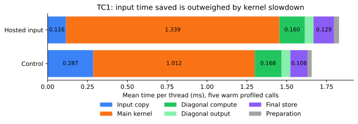

# 2026-09-12 午间：计算并发、缓存与 TC1 提前读入

本轮实验固定基于 v47 / `245bb36`，没有将慢候选合入。归档前远端已更新到队友的 v48 / `1c76567`（NEXTA），合并时保留该改动；下述数字不是对 v48 的复验。SSH 恢复后，确认旧作业 1575361 已因两小时时限终止，再提交唯一的新作业 1576379。cn20486、CPU38–75、38 线程、NUMA1 的正式测试口径保持不变；单核内核探针固定 CPU40，内存优先 HBM17。测试和文件操作均在 TRSM 专用目录内。

[原始日志和全部 665 条测量](../logs/noon_20260912/measurements.csv)、[可再生成的研究源码](noon_20260912/README.md)。这些是局部原型，不能当作线上分数。所有正式慢轮保留；以下内核吞吐不含全求解器的输入转换、对角解、任务调度和最终回写。

## SME 与 SVE 确实有并发余量，但需要同时解决数据布局

384 纯寄存器测试：每 K 步执行 8 条 FP64 FMOPA，单核约 198.394 GFLOPS；加入 4/8 条独立 SVE FMLA 后仍约 8 个核心周期，分别约 210.794 / 223.193 GFLOPS。加入 16 条 FMLA 后变为约 16 周期。简单算术的 +6.25% / +12.5% 余量得到验证，但不代表完整内核可以免费增加输出行。

之前 379、381–383 的 17/18/20 行条带已通过独立 53 位输入验证；增加标量系数读取、复制及输出后均回退。381 的单额外行在双流时约 -3.61%；383 合并两个 bank 并托管一半额外输出后仍约 -2.35%。完整旧日志也已从断线前的作业取回并归档。

386–387 改为 24×24：8 个 8×8 输出由 ZA 计算，右下 8×8 用 8 个 SVE 累加向量。SVE indexed FMLA 按 128 位分组取系数，因此用成对列的循环排列覆盖全部 64 个输出。所有 576 个输出用独立长双精度点积检查；另外用小整数输入检查长累加，误差严格为零。

| 纯计算变体 | 周期/K（约） | 单核 GFLOPS（约） |
|---|---:|---:|
| 只算 8 个 ZA tile，512 个输出 | 8.000 | 198.393 |
| 24×24，运行时 3 次 EXT 排列 | 11.754 | 151.918 |
| 24×24，B 保存四种排列 | 8.66–8.75 | 204–206 |
| 24×24，A/B 各增加一种排列 | 8.016 | 222.752 |

最后一种将 A 的后 8 行循环移位 4、B 的后 8 列循环移位 2，四种组合覆盖全部索引。它没有运行时 EXT，但增加了打包存储：A/B 每 K 的 24 个有效系数各保存为 32 个。数据来自任意输入，没有使用生成器的格点或状态。

388 的 PMU：最后一种变体 warm 样本约 5.130M cycles / 17.010M instructions，L2 refill 为零；这是驻留数据、长累加、只在末尾输出的情况。

## 把真实中间结果读写加回来，收益尚未保住

389 对 KC32/64/128 加入每块 C 的读、累加和写，另测 A 流、B 流和双流。每种 K 检查三个不同输入块的全部 18,432 个输出，最大误差 3.553e-15。

| KC | 驻留 GFLOPS | 同轮原内核 | 双流 GFLOPS | 同轮原内核 |
|---|---:|---:|---:|---:|
| 32 | 117.382 | 166.943 | 98.306 | 151.509 |
| 64 | 140.499 | 166.477 | 100.387 | 151.590 |
| 128 | 155.941 | 166.243 | 74.077 | 151.634 |

原内核使用 192×128 C，24×24 原型使用 192×96 C；表中 GFLOPS 按各自真正计算的输出计数，是组件吞吐比较，不是同一完整 TRSM 调用的胜负。所有排列副本读取和中间 C 更新均计时，初始打包没有计时。

391 将 24×24 分成两组，每组 4 个 ZA tile 加半个 SVE tile；计算一组时回写上一组。全部输出检查通过，但驻留约 127.189、双流约 100.694 GFLOPS。393 改为两组交替 SVE 累加器，仍约 125.416 / 100.026；未支持“只需打断累加依赖就能解决”的假设。394 把后半组或全部 A 改为非临时读取，最佳双流约 104.481，仍明显慢于控制内核。不能把纯计算的 +12% 作为可提交收益。

392 独立验证读取吞吐：4/8/12/16 个 64 B L1 load 分别约需 2/4/6/8 周期；8 FMOPA + 8 FMLA + 16 个独立 L1 load 约需 8.063 周期，约 196.86 GB/s 的单核 L1 读取吞吐。**额外读取次数本身不足以证明读口峰值饱和**。真实原型还存在数据依赖、C 读改写、缓存替换及更长指令序列；目前没有将剩余回退唯一归因于某一项。

## RNS 短 K 分块：验证了实际累加，仍没有端到端优势

385 新增 32×32 INT8 内核，KC64..2048，K 主序分块打包，MB/NC64/128；跨 K 段真实加载和累加 int32 C，最后执行 13 模数 CRT。旧 356 只在完整 K 或 K 分裂段末尾输出，不能直接减小 KC 而不修改累加逻辑。

64×64 小矩阵在六种 KC 下逐个检查全部 4096 输出；512×512 筛选检查 128 个独立坐标。输入为声明的 Q45 整数范围，参考为独立 `__int128` 点积，最大检查误差 2.470e-14。没有引入完整 TRSM 的量化误差保护；输入编码仍不在性能计时内。

38 线程的新实现最好 MB128/NC128/KC256：原始多模数乘法约 1316.891、加入 CRT 后约 1124.224 等效 GFLOPS。同一实现 KC2048 完整阶段约 938.314，但仍没有超过旧 356 的约 1570 组件成绩。不同原型布局不同，不能将所有差异归因于 KC。

388 对完整更新加 CRT 做六事件 PMU，下表排除首个仪器样本、取其余五次均值；所有组 running=enabled。

| KC | cycles | instructions | L2 refill lines | backend stalls |
|---|---:|---:|---:|---:|
| 64 | 84.390M | 82.820M | 4.629M | 54.563M |
| 256 | 54.911M | 43.826M | 2.619M | 39.949M |
| 2048 | 67.888M | 35.820M | 2.981M | 56.335M |

KC64 的中间 C 读写和控制开销过大；KC256 在这个实现中形成折中，但没有建立接入生产的依据。不能因为 INT8 算术峰值高，就忽略 13 份数据、编码和 CRT 成本。

## TC1：提前导入下一块，节省的搬运时间小于主循环回退

390 在 owner 内核每个 bank 的 64 步计算中分散导入下一块的一整行 96 个 FP64 数，并预取下一行。只在同线程接下来仍处理同一面板的相邻块时启用。每次求解清理元数据，进入下一块时跳过已导入行；跨面板和线程边界保持原路径。所有输入数据仍在当前调用读取。

64 组独立已知解（正负对角、极大/极小缩放、逐行缩放、错位地址、填充与 L 不变）通过。无 SME 编译需带原有 `TRSM_NO_SME_ASM` 宏，验证通过。四轮原始 bench 同二进制 `TRSM_OIMPORT=0/1` 交替、每进程 11 次计时，全部 PASS，最大误差 3.33e-16：

| 开关 | 中位 GFLOPS | 完整范围 |
|---|---:|---:|
| off | 2731.5065 | 2350.6038–2758.8553 |
| on | 2561.6291 | 2541.6450–2571.3461 |

保留控制组慢轮后，同轮比值几何平均 -2.97%；中位数变化约 -6.22%。没有和独立 v47 二进制进行生产版本晋级比较，因为同二进制对照已经明确回退。

五次 warm profile 的每线程平均：load 0.2872→0.1158 ms，kloop 1.0124→1.3386 ms，store 0.1078→0.1294 ms；节省的搬运时间没有覆盖主循环增加的时间。仪器运行的墙钟成绩不与正式四轮混合。

本轮没有新的可提交加速版本。继续研究时应以已经测出的容量和真实阶段开销为依据，避免重跑上述相同布局或把寄存器峰值外推为求解器成绩。TC1 3000 与 TC2/3 的长期目标仍未完成。
